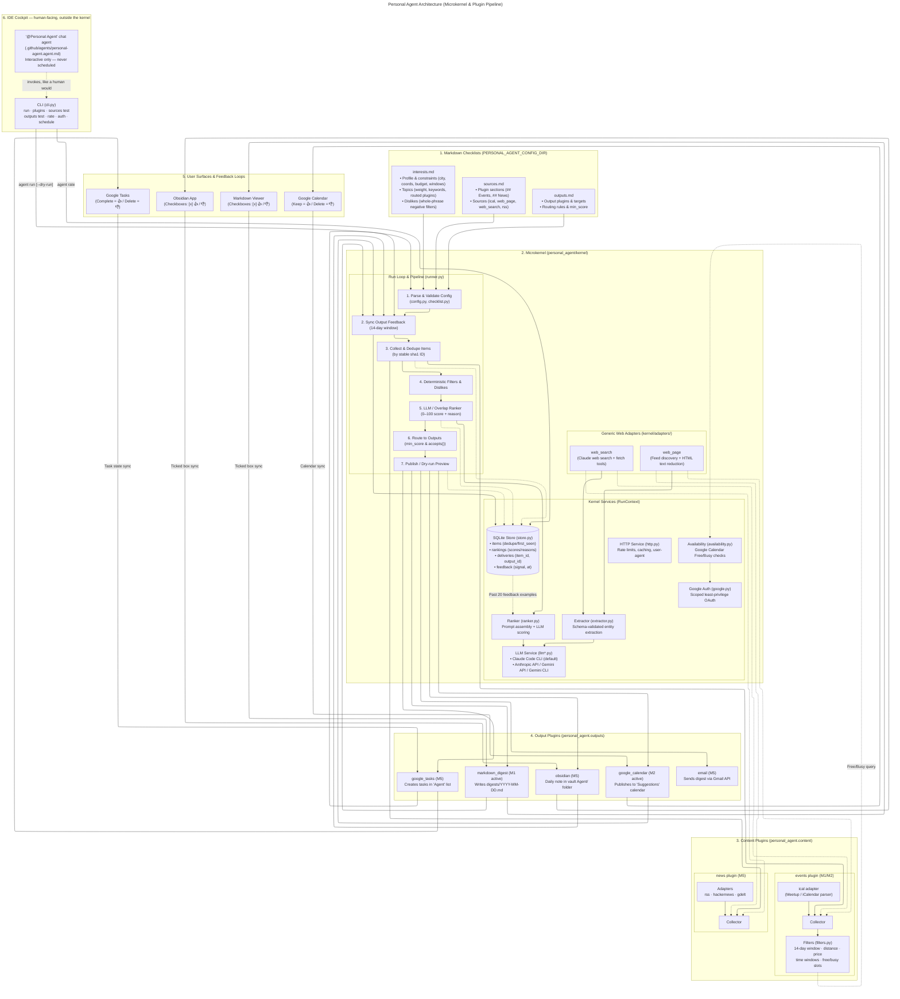
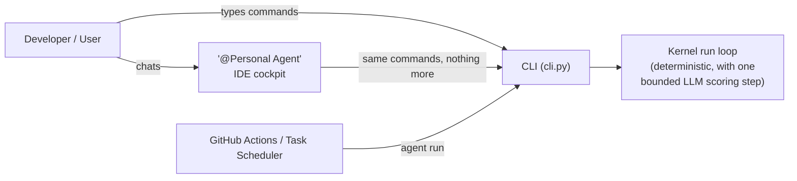

# Architecture

Personal Agent is a headless, scheduled personal assistant built on a **microkernel architecture**. It discovers events and news tailored to user preferences and publishes them to existing user surfaces: Google Calendar, Google Tasks, an Obsidian vault, markdown digests, and email.

This document details the system architecture, component boundaries, execution pipeline, and design invariants as implemented in the codebase.

---

## 1. System Architecture Diagram

---

## 2. Core Architectural Principles

1. **Microkernel Architecture**:
   - The kernel (`personal_agent/kernel/`) **never imports** from `personal_agent/plugins/`. Plugins depend on the kernel, not vice-versa.
   - Dynamic plugin discovery is performed via Python entry points (`personal_agent.content` and `personal_agent.outputs`), not hardcoded module imports.
   - Content plugins never know about outputs, and outputs never know about content plugins. The kernel router connects them using `outputs.md`.
2. **Deterministic Filters First**:
   - Filtering on hard constraints (dates, time windows, geography, budget, dislikes, busy slots) is pure, deterministic Python code with zero LLM cost.
   - Only the kernel `Ranker` and `Extractor` invoke the LLM, and only through the abstracted `LLM` interface.
3. **Idempotence & Delivery Tracking**:
   - Re-running the agent never produces duplicate calendar events, tasks, notes, or digest rows. Deliveries are tracked uniquely per `(item_id, output_id)`.
4. **Namespace Isolation**:
   - Every output writes strictly to containers it owns (e.g. *Suggestions* calendar, *Agent* task list, `digests/` directory, `Agent/` vault folder).
   - The agent never edits or deletes user-created calendar entries, notes, or tasks.
5. **Least-Privilege Security**:
   - Google OAuth credentials request only the minimal scopes declared by currently enabled outputs (e.g. `calendar.app.created`, `tasks`, `gmail.send`) plus `calendar.freebusy`. The agent never requests write access to the user's primary calendar.
   - Fetched web content, feeds, and event descriptions are treated as untrusted and encapsulated in delimited blocks with prompt injection guards.
6. **CLI as the Single Integration Boundary**:
   - Every caller of the system — the scheduled cloud/local run and the optional IDE cockpit (§6) — goes through `cli.py`. Nothing outside `personal_agent/kernel` and `personal_agent/plugins` imports those packages directly, so the invariants above hold regardless of who or what invokes a run.

---

## 3. Subsystem Breakdown

### 3.1. Configuration Layer (`config/*.md`)

User preferences and settings are stored in plain Markdown checklists in `PERSONAL_AGENT_CONFIG_DIR` (default `config/`):

- `interests.md`: Defines the user profile (city, coordinates, timezone, budget, time windows), interest topics with weights and keywords, and exclusion dislikes.
- `sources.md`: Partitioned by content plugin sections (`## Events`, `## News`). Lists feed URLs and adapter types (`ical`, `web_page`, `web_search`, `rss`).
- `outputs.md`: Lists destination output configurations, plugin routing rules, and minimum scores required for delivery.

Because configurations are plain Markdown checklists, users can edit them directly in Obsidian, GitHub, or any text editor on desktop and mobile.

### 3.2. Microkernel Core (`personal_agent/kernel/`)

- **Plugin Registry (`plugin.py`)**: Defines `ContentPlugin` and `OutputPlugin` protocols and discovers plugins via `importlib.metadata.entry_points`.
- **Run Loop & Router (`runner.py`)**:
  1. **Config Validation**: Parses Markdown into strongly-typed Pydantic models.
  2. **Feedback Synchronization**: Queries enabled outputs for user signals over the past 14 days and writes them to the database.
  3. **Collection & Deduplication**: Fetches items from all sources, generates stable SHA-1 item IDs, and drops items already delivered to all routed outputs.
  4. **Filtering**: Runs deterministic domain filters and drops items matching active dislikes.
  5. **Ranking**: Prompts the LLM to score remaining candidates (0–100) and generate rationale, conditioned on the user's past feedback.
  6. **Routing & Publishing**: Dispatches accepted items above the minimum score to target outputs; records deliveries.
- **Fault Isolation**: A failure in any source adapter, plugin, or output is logged as a non-fatal warning; it never halts the run loop.

### 3.3. Shared Kernel Services (`kernel/services/`)

- **Store (`store.py`)**: Embedded SQLite database (`agent.db`) managing `items`, `rankings`, `deliveries`, and `feedback`.
- **Ranker (`ranker.py`)**: Batch scoring engine with prompt construction including the top 20 recent user feedback signals. Falls back to keyword-overlap ranking when no LLM key is configured.
- **Extractor (`extractor.py`)**: Schema-validated entity extraction from raw web text using the LLM.
- **LLM Abstraction (`llm.py`)**: Uniform provider interface for structured parsing. `PERSONAL_AGENT_LLM_PROVIDER` selects Claude Code CLI (`claude_code`, default, `llm_claude_code.py`), Anthropic API (`anthropic_api`, `llm.py`), Gemini API (`gemini_api`, `llm_gemini_api.py`) or Gemini CLI (`gemini_cli`, `llm_gemini_cli.py`); shared JSON retry, clean-environment subprocess runner and redirect resolution live in `llm_common.py`. A `Guarded` wrapper turns the first "unavailable" error (logged out, bad key, limit) into fail-fast for the rest of the run.
- **Availability (`availability.py`)**: Queries Google Calendar Free/Busy API to eliminate suggestions conflicting with the user's schedule.
- **Google Auth (`google.py`)**: Scoped token management storing credentials in the OS keyring (locally) or environment variables (cloud).
- **HTTP Client (`http.py`)**: Centralized `httpx` client enforcing rate limits (1 req/s per host), timeouts (20s), and user-agent headers.
- **Checklist (`checklist.py`)**: Shared parser and renderer for `- [ ] 👍 / 👎` items, ensuring consistent formatting between config parsing and digest outputs.

### 3.4. Generic Web Adapters (`kernel/adapters/`)

Reusable adapters available to any content plugin without site-specific scraping code:

- **`web_page`**: Respects `robots.txt`, detects advertised `.ics` or RSS/Atom feeds automatically (feed discovery), reduces HTML to readable text, and caches document hashes to avoid redundant LLM extraction.
- **`web_search`**: Leverages Claude server-side search and web fetch tools to discover items matching weighted topics within allowed domains.

### 3.5. Content Plugins (`personal_agent/plugins/content/`)

- **`events`**:
  - Built-in adapters: `ical` (iCalendar/Meetup feeds with recurring event expansion), plus generic `web_search` and `web_page`.
  - Filters: Event horizon (next 14 days), maximum distance (haversine formula), ticket price cap, time windows (e.g. weekday evenings, weekends), and busy calendar slots.
- **`news`**:
  - Adapters: `rss`, `hackernews`, `gdelt`, plus generic web adapters.
  - Filters: Publication recency (≤ 48 hours), topic relevance, and cross-source deduplication.

### 3.6. Output Plugins (`personal_agent/plugins/outputs/`)

- **`google_calendar`**: Publishes tentative event suggestions with matching rationale and URLs to a dedicated *Suggestions* calendar. Syncs feedback: kept events = accepted, deleted events = rejected.
- **`markdown_digest`**: Generates daily Markdown summaries in `digests/YYYY-MM-DD.md` with interactive `[ ] 👍` / `[ ] 👎` rating checkboxes.
- **`obsidian`**: Appends daily notes to `<vault>/Agent/YYYY-MM-DD.md` with frontmatter tags and rating checkboxes.
- **`google_tasks`**: Creates tasks in an *Agent* task list with due dates; completed = positive, deleted = negative.
- **`email`**: Dispatches HTML/Markdown digests via the Gmail API (`gmail.send`).

---

## 4. Feedback & Learning Loop

The feedback loop is bidirectional and multi-surface:

1. **Implicit & Explicit Interaction**: Users interact with items in whichever surface they naturally use:
   - Calendar: keeping an event accepts it; deleting it rejects it.
   - Tasks: completing a task marks it positive; deleting marks it negative.
   - Digest / Obsidian: ticking `[x] 👍` or `[x] 👎` records a rating.
   - CLI: `agent rate <item-id> up|down` records ratings directly.
2. **Synchronization**: On every run, `sync_feedback()` polls outputs for signals across deliveries from the last 14 days and writes them to the SQLite `feedback` table.
3. **Adaptive Prompting**: The `Ranker` pulls the 20 most recent feedback entries into its prompt context, allowing the LLM to learn user preferences dynamically over time without fine-tuning.

---

## 5. Deployment & Execution Models

- **Thin-Client Philosophy**: The agent runs as a headless scheduled background process. Desktop PCs and mobile phones (Android/iOS) function as thin clients using standard apps (Google Calendar, Tasks, Obsidian, Gmail, Web).
- **Cloud Mode (GitHub Actions)**:
  - Runs on a GitHub Actions `schedule:` cron trigger in a private repository.
  - State (`agent.db`) is committed and pushed to an orphan `state` branch.
  - Secrets and OAuth tokens are stored in GitHub Actions encrypted repository secrets.
- **Local Mode (Windows / macOS / Linux)**:
  - Installed via `pipx`.
  - Scheduled via OS-native schedulers (`agent schedule install` registers Windows Task Scheduler, `cron`, or `launchd`).
  - State and caches live in OS standard directories (`platformdirs`), and tokens are stored in the OS keyring (`keyring`).

---

## 6. IDE Cockpit: A Human-Facing Layer, Not a Fourth Pipeline Stage

Personal Agent involves **two conceptually distinct uses of an LLM**, plus an optional
human-facing chat layer. Keeping these three apart is what keeps the architecture sound, so
this section makes the boundary explicit.

| Layer | What it is | Lives in | Calls the LLM? | Runs unattended? |
|---|---|---|---|---|
| **Kernel `Ranker` / `Extractor`** | Narrow, structured, cost-accounted LLM calls inside the run loop (§3.3) | `personal_agent/kernel/services/{ranker,extractor,llm}.py` | Yes — the *only* place that does | Yes (this is the product) |
| **CLI (`cli.py`)** | The single integration boundary into the kernel: `run`, `plugins`, `sources test`, `outputs test`, `rate`, `auth google`, `schedule` | `personal_agent/cli.py` | No | Yes, via the scheduler |
| **IDE cockpit (`@Personal Agent`)** | A VS Code custom agent that wraps the CLI for interactive config editing, source/output testing and troubleshooting | `.github/agents/personal-agent.agent.md` | No — it's a conversational tool invoking the CLI, not a kernel component | **No — interactive only** |

### Why this separation matters

- **The cockpit is not "an agent wrapping an agent."** It's a chat interface over the same CLI
  a person would type by hand. It never imports `personal_agent.kernel` or
  `personal_agent.plugins`, opens the SQLite store directly, or calls an LLM provider itself —
  so every kernel invariant (idempotency, namespace isolation, scoped OAuth, fault isolation)
  holds regardless of whether a human or the cockpit issued the command.
- **Automation never depends on the cockpit.** Scheduled runs are GitHub Actions or the OS
  scheduler (§5); the cockpit only acts while someone is in a chat session, and if VS Code is
  closed, scheduled runs are completely unaffected.
- **The kernel's own LLM use is bounded and separate.** `Ranker`/`Extractor` calls are
  structured-output-only (score + reason, or validated `Item` fields) and cost-tracked per run
  (`LLM: claude-opus-5-5, N call(s), … tokens, ~$X`). There is no autonomous decision-making
  loop anywhere in the kernel beyond that one scoring step — filtering, routing and publishing
  remain deterministic Python.
- **Write access is scoped, and enforced, not just written.** A `PreToolUse` hook
  (`scripts/check_cockpit_edit_scope.py`, wired in the cockpit's own frontmatter) denies any
  `edit`/`create` call whose target falls outside `config/*.md` and `docs/`, so changes to
  `kernel/` or `plugins/` code are mechanically blocked rather than merely discouraged by
  instructions — a casual chat instruction can't accidentally violate the "kernel never
  imports plugins" rule or the idempotent-publish contract. It does not inspect `execute`
  (shell) calls for redirection-based writes, which remains a known, documented gap.

